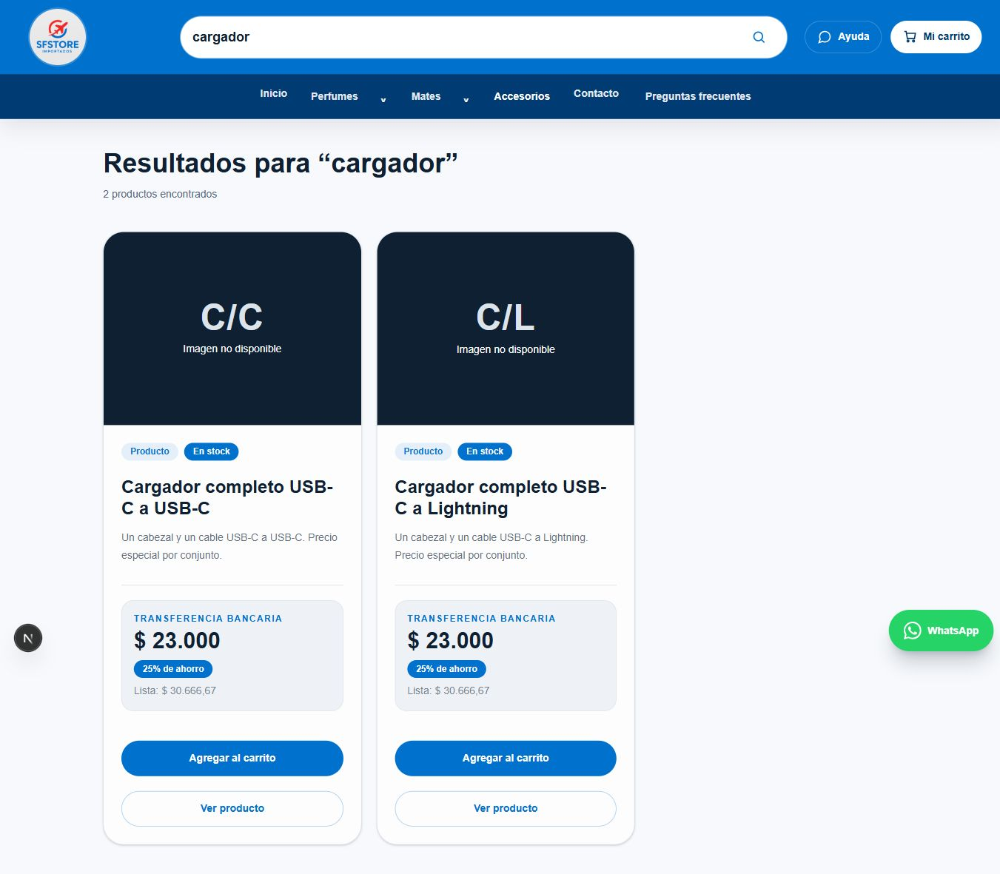
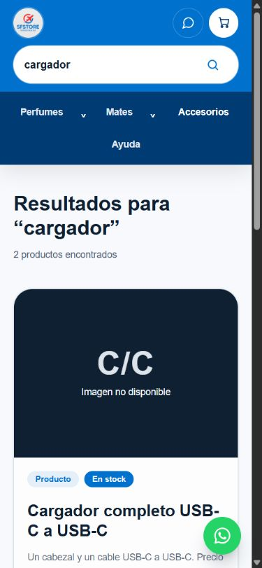
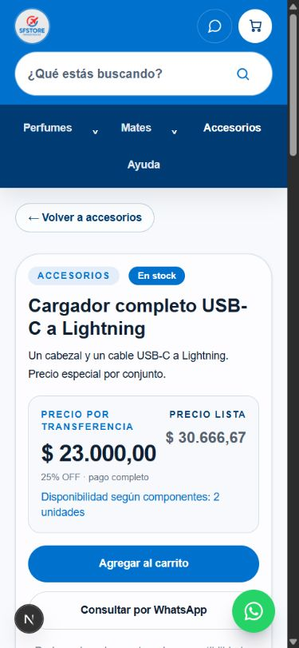

# SFSTORE — UX-N01: corrección local del buscador

Fecha: 22/10/2026. Rama `codex/catalog-search-fix-20261022`, basada exactamente en `6be98d3682a0ca8a932b05e3c95cb8637a748647`.

**Estado: implementado y validado localmente, sin publicar.** Se utilizó el diagnóstico incremental y la sección 9 del [Plan de Mejora Continua local consolidado](../../../charger-purchase-ux-20261022/docs/SFSTORE-PLAN-MEJORA-CONTINUA.md#9-diagnostico-consolidado-al-22102026). Los informes, capturas y cambios documentales anteriores se preservaron en su worktree; no se arrastraron a la nueva rama como cambios funcionales.

## Causa confirmada y corrección mínima

`app/buscar/page.tsx` reunía únicamente `getProductsByCategorySlug("perfumes")` y `getProductsByCategorySlug("mates")`. Al separarse correctamente Accesorios, sus productos físicos y publicaciones virtuales quedaron fuera del universo de búsqueda. El filtro textual no era el problema.

Se reemplazaron esas dos lecturas por **una llamada a `getCatalogPublications()`**, ya existente. El buscador sigue aplicando `searchProducts()` sin cambios, incluyendo normalización de acentos/mayúsculas, coincidencia de todas las palabras y búsqueda en opciones de variantes. Ahora usa las mismas publicaciones públicas que el resto de la tienda: productos simples, familias agrupadas y las dos presentaciones virtuales.

No se agrega una lista de categorías al buscador. Una categoría activa nueva aparece a través del servicio público sin tener que modificar esta página. Las rutas de categoría conservan `getProductsByCategorySlug()` y sus filtros existentes; no se agregó un parámetro de categoría que antes no existía.

Se conservan vistas públicas, permisos y exclusiones actuales. No se consulta directamente productos privados ni se amplían columnas. Los precios, recetas, costos, stock, carrito y checkout no tienen cambios de código.

## Pruebas automatizadas afectadas

Antes de cambiar la página se ejecutaron las nueve pruebas nuevas: **seis fallaron**, reproduciendo la ausencia de combos, cables y categoría nueva, además del listado incompleto. Después de la corrección aprobaron.

Comando focalizado:

```powershell
node --test tests/catalog-search.test.mjs tests/catalog-search-page.test.mjs tests/public-product-visibility.test.mjs tests/component-publications.test.mjs
```

**Resultado: 33/33 aprobadas, cero omisiones.** No se ejecutó la suite general.

Las nueve pruebas nuevas ejecutan la página real y el servicio de catálogo real mediante el patrón de carga TypeScript usado por las pruebas existentes. Solo se sustituyen la frontera de Supabase y los componentes de presentación de la prueba. La paginación recibe deliberadamente una fila por respuesta, incluyendo ofertas con igual ID y distinto conector.

Cobertura nueva:

1. «Cargador» devuelve los dos conectores, con URL única, lista $30.666,67 y transferencia $23.000, sin duplicación ni lectura repetida por sección.
2. Búsquedas de perfume, mate, termo y cables, incluyendo ambos conectores.
3. Categoría sintética no registrada en el buscador: Lámpara sigue apareciendo.
4. Búsqueda vacía devuelve diez publicaciones únicas del fixture: ocho simples/familiares más dos combos; los dos SKU familiares se agrupan en una publicación.
5. Filtros de Perfumes/Mates/Accesorios siguen limitando cada página a su sección.
6. Estados archivado/borrador, categoría inactiva e identidad histórica no aparecen. La protección de ocultos/bloqueados sigue a cargo de las proyecciones públicas existentes, que no fueron modificadas; no se pretende haber reauditado RLS.
7. Fallo de lectura y ausencia de ofertas no inventan combos; recuperación de búsqueda sin resultados conserva `/buscar`.
8. Parámetros de búsqueda múltiples y escape de caracteres especiales.
9. Ninguna consulta muta fixtures de precios, stock u ofertas.

También se reutilizaron las pruebas existentes de privacidad pública, agrupación, proyección de combos, conectores y contrato de precios. El aviso existente de Node sobre `MODULE_TYPELESS_PACKAGE_JSON` no se silenció ni motivó un cambio de configuración.

TypeScript `tsc --noEmit`, ESLint de los cuatro archivos de página/pruebas/fixture y `git diff --check`: **aprobados, exit code 0**. Next compiló las rutas locales usadas por la revisión. No se ejecutó un build de publicación ni la suite general, conforme al alcance focalizado.

## Validación visual y HTTP local

Se levantó la aplicación Next.js real de esta rama, exclusivamente en `127.0.0.1:3152`, contra un **fixture HTTP local de solo GET** con datos sintéticos. Las respuestas tienen el formato de las dos vistas públicas y se consumen mediante el cliente Supabase y servicio reales. **No es una nueva validación de PostgreSQL, Auth o RLS**; no hace falta repetirlas para este cambio de consumidor.

El lanzador rechaza archivos `.env` de ejecución y construye un entorno permitido sin heredar credenciales productivas. La clave del fixture es una cadena sintética sin privilegios, no una credencial. No se utilizó Supabase Production, no se creó una base ni se ejecutó SQL.

| Búsqueda | Notebook 1366 × 900 | Móvil 390 × 844 | Resultado esperado del fixture |
|---|---:|---:|---|
| perfume | 1 | 1 | Perfume Ámbar |
| mate | 1 | 1 | Mate imperial |
| termo | 2 | 2 | Termo simple y una familia, sin duplicar sus colores |
| cable | 4 | 4 | Dos cables individuales y dos combos que incluyen cable |
| cargador | 2 | 2 | Los dos combos independientes |

Además:

- Se abrió la ficha C/C desde resultado en notebook y Lightning desde resultado móvil: cada URL conserva el conector exacto y muestra $23.000 transferencia / $30.666,67 lista.
- Lámpara, de una categoría nueva, devuelve un resultado sin añadir su slug al buscador.
- Búsqueda inexistente muestra cero y el enlace «Ver todos los productos» recupera las diez publicaciones.
- Navegación por sección: Perfumes 1, Mates 3 y Accesorios 6, sin electrónica en Mates.
- En la ficha móvil medida, documento 375 px dentro del viewport 390 px con scrollbar; CTA 48 px. No se observaron cortes horizontales en las vistas revisadas. No equivale a una certificación en teléfono físico o Safari.
- No se agregó nada al carrito ni se confirmó un pedido. No se completó CAPTCHA ni se abrió un enlace de contacto externo.

El primer acceso al navegador agotó su espera mientras Next compilaba la ruta. El servidor respondió HTTP 200 y se recuperó la misma pestaña; no se atribuyó esa espera inicial de desarrollo a Production ni se cambió código para ocultarla.

### Capturas locales inspeccionadas

Todas son de esta ejecución con fixtures sintéticos. Los placeholders son deliberados: no se inventaron fotografías. Las capturas de notebook completas abarcan la página, por lo que su alto puede exceder el viewport.







Otras evidencias: [ficha C/C notebook](assets/2026-10-22-buscador/02-ficha-cc-notebook.jpg), [cables móvil](assets/2026-10-22-buscador/03-cables-movil.jpg), [categoría nueva](assets/2026-10-22-buscador/06-categoria-nueva-movil.jpg), [vacío real](assets/2026-10-22-buscador/07-vacio-real-movil.jpg), [recuperación a todos](assets/2026-10-22-buscador/08-todos-movil.jpg) y [resultados estructurados](assets/2026-10-22-buscador/visual-results.json).

## Archivos y alcance

- `app/buscar/page.tsx`: único archivo funcional modificado; consumidor del catálogo público común.
- `tests/catalog-search-page.test.mjs`: nueve pruebas de regresión de página/servicio.
- `tests/fixtures/search-public-catalog.mjs`: publicaciones sintéticas y frontera HTTP local GET-only.
- `tests/fixtures/search-preview.mjs`: lanzador local reproducible y entorno aislado de credenciales productivas.
- Este informe y ocho capturas con resultados JSON: evidencia de la entrega.
- Plan maestro consolidado en el worktree anterior: UX-N01 pasa a **En validación local, sin publicar**; los demás pendientes no se desarrollaron.

No cambian `services/products.ts`, normalización de búsqueda, filtros de categorías, precios, recetas, migraciones ni lógica de checkout. No se agregaron dependencias. Se reutilizaron las dependencias instaladas mediante una junction local, sin alterar el lockfile.

## Límites y siguiente paso

El arreglo está validado localmente; **Production aún conserva la regresión hasta que se autorice y ejecute una publicación posterior**. El número real de resultados depende del catálogo público vigente: los dos resultados del fixture no son un nuevo conteo de Production.

No se cambiaron mensajes generales de error del servicio de catálogo: su comportamiento existente ante fallos queda preservado y no se presenta como una mejora de esta tarea. No se ejecutó una suite comercial general ni se repitieron auditorías.

No hubo push, merge, despliegue ni modificación productiva. La implementación se entregó inicialmente sin commit; su preparación posterior de publicación identifica el commit candidato exacto en el manifiesto privado de release, sin cambiar la corrección funcional.

Se cerraron las pestañas temporales y se restauró el viewport. Se terminaron exclusivamente el fixture y su árbol de procesos Next, identificados por PID y comando exacto; no se detuvieron otros servidores. Las ocho capturas fueron abiertas y las referencias locales del informe se verificaron sin faltantes.
