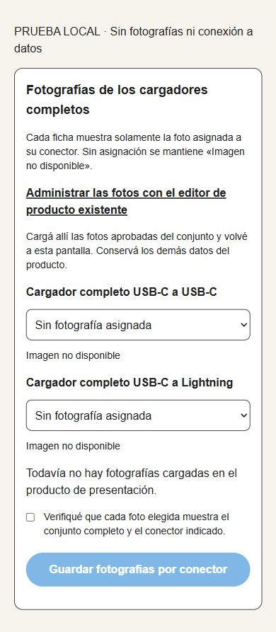

# P02 — Asociación de fotografías de cargadores virtuales

Estado: implementado y validado localmente; no publicado. Base `46f0a216e45cec6c983927e4b71df28f59d54a90`, rama `codex/p02-combo-images-20261024`.

## Solución

Se reutilizan `product_images`, el bucket existente, el editor de productos y la galería pública. No hay nuevas tablas de imágenes, buckets, copias físicas de componentes ni stock de combos.

Una nueva columna opcional `product_images.combo_connector` asocia explícitamente una fotografía del producto de presentación a `cc` o `lightning`. No se deduce por nombre de archivo, orden de galería o foto principal. Las fotos sin etiqueta conservan su comportamiento anterior.

La proyección pública existente copia únicamente ID, URL y texto alternativo de la foto asignada. Sus triggers mantienen esa metadata al editar/eliminar imágenes o regenerar publicaciones; no cambian los campos comerciales. La vista conserva `security_invoker=true`, `security_barrier=true`, sus primeras doce columnas y las políticas RLS existentes. No se abre acceso público a recetas o fotos del SKU bloqueado de presentación. Las funciones nuevas son invoker y su ejecución está restringida a `service_role`; la acción administrativa exige previamente la sesión autorizada existente.

Cada ficha y tarjeta del catálogo recibe su propia imagen principal y galería de una foto. Sin asociación válida, conserva el placeholder. No toma fotografías del cabezal, cable ni otro conector. IDs o URLs repetidos entre conectores se rechazan en PostgreSQL y se ocultan defensivamente en la proyección TypeScript. La correspondencia visual del contenido requiere aprobación humana; un identificador distinto no demuestra que el contenido muestre el conector correcto.

En `/admin/productos/componentes` hay una selección por conector con vista previa y confirmación explícita. Se rechazan imágenes de otro producto o la misma imagen para ambos conectores. La asociación se guarda en una transacción; repetirla no duplica registros. La página carga imágenes en lote y avisa si falla la consulta o excede el límite explícito.

## Migración preparada, no aplicada

`supabase/migrations/202610240001_component_offer_images.sql`.

SHA-256 LF: `97d93450760288866736b540189c5cb98be28e5a271fc00edd1c4f8f5c02d4f0`.

Migración aditiva y transaccional, `lock_timeout=3s`. Ninguna migración histórica se modificó. Manifiesto de staging actualizado a 38 versiones con el generador existente, sin ejecución remota. No carga ni etiqueta fotos existentes automáticamente.

Para una futura publicación autorizada debe aplicarse primero el contrato SQL y después el código: el lector nuevo solicita las tres columnas nuevas. Publicarlo antes de migrar haría fallar la lectura de ofertas. El código previo puede coexistir con el esquema ampliado; simplemente sigue mostrando placeholders en los combos. Una recuperación de código puede conservar el esquema aditivo y las asociaciones, sin revertir productos ni inventario. Ante fallo de DDL se revierte la transacción; no repetir sin verificar el estado.

## Validaciones

- 20 pruebas de publicaciones/servicios/UI/autorización aprobadas: fotos independientes, falta de foto sin herencia, rechazo de IDs/URLs compartidos y URLs no HTTPS; catálogo paginado y ficha coincidentes; acción exige admin y aprobación; formulario sin fotos deshabilitado. Se conservan las cinco presentaciones, stock derivado, precios y payload de checkout por UUID/conector.
- 8 comprobaciones PostgreSQL aprobadas en contenedor descartable `postgres:17.6`, `--network none`, sin puertos publicados y con datos sintéticos: asociación, repetición, duplicados/otro producto, rollback, refresco, edición de galería, borrado/truncate, RLS y permisos. Los valores de stock, precio y costo del fixture permanecieron iguales. Contenedor eliminado al terminar.
- Build y TypeScript aprobados. ESLint focalizado sin errores; una advertencia de `img` en la vista previa administrativa, que reutiliza URLs existentes y no introduce optimización remota.
- Revisión visual del componente real renderizado en fixture estático local, sin Auth/Supabase/Storage: 390×844 y 1366×900, sin overflow, selectores de 44 px, etiquetas diferentes, botón deshabilitado sin imágenes. No equivale a un recorrido interactivo completo de Supabase ni valida fotografías reales, que siguen pendientes. La primera captura del fixture heredó el color oscuro del `body`; se corrigió únicamente el envoltorio de prueba para reproducir el fondo y texto del administrador, sin cambiar el diseño funcional.
- El sandbox no tenía acceso a Docker; se ejecutó la misma prueba con el acceso local autorizado al motor, manteniendo aislamiento. No se cambiaron permisos globales ni servicios.

## Cómo incorporar las fotografías cuando estén disponibles

1. Aprobar una foto real del conjunto C/C y otra del conjunto Lightning, mostrando los extremos del cable. No usar una foto de un componente individual como si fuera el conjunto.
2. Tras autorizar y publicar este contrato/código, abrir desde Componentes el editor existente del producto de presentación. Cargar las dos imágenes con el flujo actual; conservar los demás campos y no crear nuevos SKU, recetas o buckets.
3. Volver a Componentes, elegir la foto exacta de cada conector, comprobar las vistas previas y confirmar la correspondencia. Una selección vacía deja ese combo sin fotografía.
4. Guardar y revisar ambas URLs virtuales y las tarjetas en móvil/notebook. Confirmar fotografía, nombre y conector; precios aprobados e inventario compartido deben permanecer iguales. No se necesitan pedidos de prueba reales para esta revisión.

Pendientes: fotografías reales aprobadas, validación visual final con esos archivos y autorización separada para migración/publicación. No se consultó ni modificó Production durante esta implementación. Sin push, merge ni despliegue.

[Formulario en notebook](assets/2026-10-24-p02-combo-images/asociacion-vacia-notebook.jpg).
