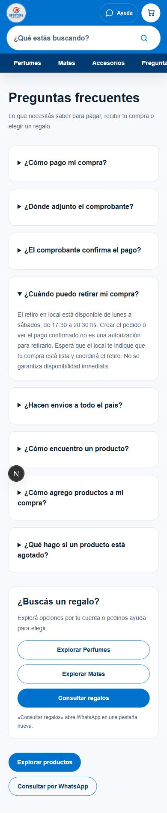
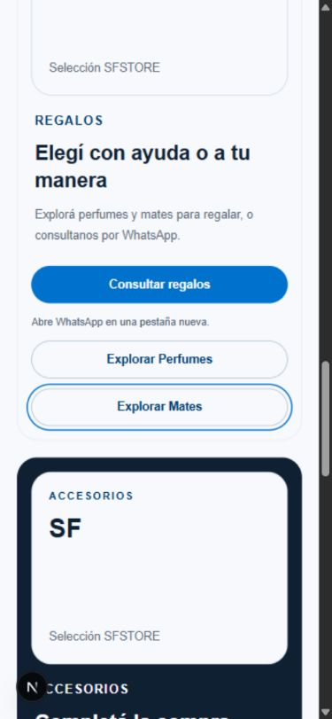

# P09 — Pagos, entregas y regalos

Fecha: 24/10/2026. Rama: `codex/p09-help-gifts-20261024`. Base: `1ff392daad41200ca7b6dbe53adcac1086b66128` (main remoto). Estado: implementación local, sin publicar.

## Cambios

- Ayuda explica transferencia completa con el 25% vigente sobre productos, total definitivo y carga del comprobante dentro del pedido. No deriva ese trámite a WhatsApp.
- Distingue pedido creado, pago informado, acreditación verificada y autorización de retiro. Horario aprobado: lunes a sábados, 17:30–20:30. No promete retiro inmediato.
- Explica envíos nacionales, datos y preferencia de transportista en checkout, tarifa aprobada y solicitud de cotización cuando no hay tarifa; no promete importes ni plazos.
- Regalos en Inicio y Ayuda ofrece exploración directa de Perfumes y Mates. «Consultar regalos» identifica expresamente WhatsApp y apertura de otra pestaña. La tarjeta tiene acciones separadas, sin enlaces anidados.
- Se conservan estilos existentes, acordeones nativos, navegación, fotografías y las demás categorías.

## Contratos verificados en código

`components/checkout-payment-report-form.tsx` informa el pago y adjunta PDF, PNG o JPEG de hasta 3 MiB. El comprobante deja el pago pendiente de verificación; no acredita fondos.

`services/checkout-manual-admin.ts` y `app/admin/checkout/actions.ts` acreditan mediante administrador autorizado y `confirm_checkout_manual_payment`. `app/checkout/exito/page.tsx` diferencia el aviso del pago confirmado y advierte que WhatsApp no reemplaza el comprobante.

Las rutas de Mercado Pago `create-preference` y `webhook` responden con pagos automáticos deshabilitados. No se encontró confirmación bancaria automática operativa en el código de main revisado. No se inspeccionaron configuraciones privadas externas: este resultado acredita el flujo implementado, no la ausencia universal de sistemas externos.

`app/checkout/page.tsx` contiene datos de entrega y preferencia entre Correo Argentino, Andreani y Via Cargo. La preferencia no contrata transporte. Sin tarifa aprobada, requiere cotización antes de preparar el pedido o transferir.

No se modificaron estos contratos ni archivos operativos. No se consultó ni modificó Supabase, ni se crearon pedidos.

## Validación focalizada

- 17 pruebas automatizadas aprobadas: 4 nuevas de P09, 8 de límites del reporte de pago, 2 de autorización de envío y 3 de experiencia de compra/precios existentes.
- ESLint focalizado: sin errores; advertencia preexistente de `img` en Inicio.
- Navegación local sin credenciales productivas: Ayuda, Inicio y acceso directo a Mates respondieron correctamente. Inicio muestra ausencia de destacados y las categorías usan recursos alternativos existentes; las capturas no validan fotografías reales ni datos de Production.
- Celular 390×844 y notebook 1366×900: sin desbordamiento horizontal del documento. Nuevos enlaces y resúmenes de preguntas con área de al menos 44 px. Acordeones abren con toque/Espacio y cierran con Enter; enlaces accesibles por teclado y foco visible.
- Las URLs y la advertencia de WhatsApp se verificaron sin enviar mensajes ni abrir conversaciones.
- Build de producción (`next build --webpack`) y su comprobación TypeScript: aprobados. El primer build tuvo `EPERM` del sandbox al crear una carpeta de salida `.next`; el reintento local sin esa restricción terminó correctamente, sin alterar código.

## Evidencia

[Ayuda en notebook](assets/2026-10-24-p09/ayuda-notebook.jpg) · [Regalos en notebook](assets/2026-10-24-p09/regalos-notebook.jpg).

## Límites y seguimiento

No hay decisiones comerciales nuevas necesarias para estos textos. La confirmación bancaria automática no debe anunciarse como disponible a partir del código verificado. No se agregaron promesas ni mecanismos de notificación de retiro.

No se probó un dispositivo físico ni Instagram WebView. No hay medición de conversión antes/después; el beneficio esperado es reducir dudas y evitar transferencias o retiros anticipados. No se añadieron rastreadores ni eventos. Un seguimiento posterior puede medir consultas recurrentes de pago/retiro y abandono, con autorización y herramientas ya aprobadas.

No hubo push, merge, despliegue ni cambios en servicios. P09 queda listo para revisión local; publicación pendiente de autorización.
