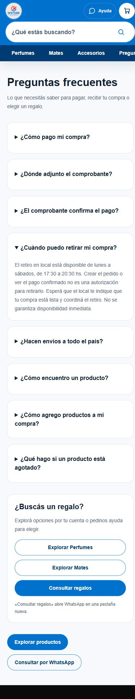

# P09 — Publicación controlada

Fecha: 24/10/2026. Código publicado: `8f3c7ad6b4ea8f53d56a69ef349d29c02c9a60f9`.

- Proyecto Vercel `sfstore`, equipo verificado. Deployment anterior: `dpl_ATk4WoDC8JEkrCQ2kujDn542dhoo`.
- Automatic confirmado antes del corte; bloqueo temporal «Don't build anything» guardado y confirmado después de recargar antes del push.
- Rama y main avanzaron por fast-forward al SHA autorizado; sin incorporar cambios funcionales ajenos.
- Construcción con `--prod --skip-domain`, checkout separado sin archivos privados ni credenciales. Build y TypeScript remotos aprobados. Las 17 pruebas locales aprobadas no se repitieron.
- 616 archivos fuente subidos cotejados: cero discrepancias contra el upload local; cero diferencias de contenido con Git, con normalización CRLF/LF en 297 archivos. No se modificó código para construir.
- URL temporal protegida: petición sin autenticar redirige a Vercel. Navegación con sesión autorizada, sin generar bypass ni cambiar protección.
- Deployment final `dpl_9DAtHX7BGcNzaUgZPbFp2M9w2Koo`, READY; promoción explícita después de comprobar Ayuda, Regalos, carrito y checkout. El alias público fue consultado y corresponde al SHA autorizado.

## Verificaciones posteriores

- GET 200: Inicio, Ayuda, Perfumes, Mates, carrito, checkout y login administrativo.
- Ayuda muestra 25%, comprobante dentro del pedido, verificación manual y retiro de lunes a sábados 17:30–20:30, sin autorización implícita para retirar.
- Regalos distingue WhatsApp de exploración directa; navegación desde Ayuda a Perfumes verificada.
- Móvil 390×844 y notebook 1366×900 sin desbordamiento horizontal del documento. Accesos y fotografías productivas existentes conservados.
- Carrito: una unidad de un producto público, lista $143.803,64, descuento $35.950,91 y transferencia $107.852,73. Checkout conserva $107.852,73 y el flujo existente de comprobante/acreditación manual. No se pulsó «Preparar pedido», no se introdujeron datos de comprador ni se completó CAPTCHA. Selección local eliminada al terminar.
- Ruta de pagos automáticos conserva HTTP 410 `AUTOMATIC_PAYMENTS_DISABLED`. No se anuncia automatización bancaria como disponible.

## Límites e incidencias

No se repitió una compra completa ni se probaron acreditaciones, por la prohibición de crear operaciones productivas. No hubo cambios de Supabase, inventario, pagos o checkout. No se verificó dispositivo físico ni Instagram WebView ni se midió conversión.

El visor de metadatos truncaba árboles profundos; se usó la lectura oficial de Vercel CLI para comparar la lista completa. Python del sandbox no estaba disponible; se utilizó el intérprete existente del perfil habitual. Son incidencias locales resueltas, sin cambios de credenciales o configuración comercial.

La consola del iframe de Cloudflare Turnstile emitió dos mensajes opacos `NaN`; no se observó un error funcional del formulario ni se verificó la resolución de CAPTCHA durante este recorrido. No se cambió autenticación ni se atribuye el mensaje a P09.

El cierre de Automatic y la ausencia de builds pendientes se comprueban después del último push documental; su evidencia se conserva en el registro privado del corte.

[Regalos publicado en notebook](assets/2026-10-24-p09-publicado/regalos-notebook.jpg).
