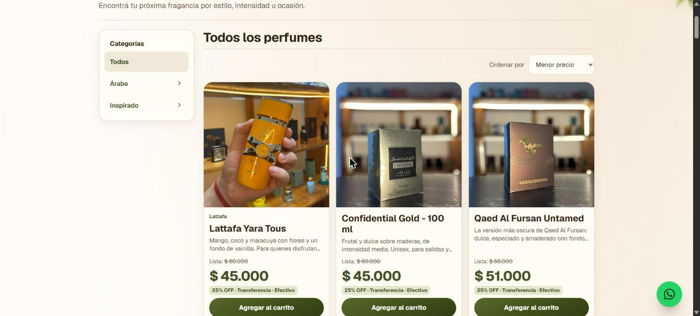

# I3 — Propuesta: ordenar el catálogo por precio (27/11/2026)

Estado: **propuesta para aprobar**. Implementada en el PR #45 (borrador, rama `claude/catalogo-orden-precio`), sin integrar ni publicar. El backlog pide una propuesta antes de agregar un control al diseño aprobado del catálogo.

## Qué ve el cliente

La maqueta se armó en una pestaña local sobre la página de producción, con los productos reales y las mismas clases de diseño que usa el componente. No se cambió nada publicado.

- En **Perfumes** y **Mates** aparece el selector «Ordenar por», alineado a la derecha sobre la grilla.
- Opciones:
  - **Recomendados**: el orden actual y el predeterminado.
  - **Menor precio**.
  - **Mayor precio**.
- Solo se muestra cuando hay más de un resultado.
- **Escritorio**: va debajo del título de la sección, como en la captura.
- **Móvil**: queda debajo del botón «Elegí a tu gusto», a todo el ancho de la columna. Usa el mismo estilo de selector que ese panel y mide 44 px de alto como mínimo, para el tacto.
- Elegir una opción reordena sin recargar la página y conserva la categoría y los filtros activos.
- La dirección es compartible: `/perfumes?orden=menor-precio`.

## Reglas de orden

1. **Disponibles primero**, como hoy. Los agotados siguen al final y se ordenan entre sí con el mismo criterio.
2. **Precio que se compara**: el que la tarjeta muestra grande, es decir, contado o transferencia. Si un producto no tiene precio de contado válido, se usa el de lista. Las familias de variantes usan su precio «Desde».
3. **Productos con «Consultar precio»**: van al final de los disponibles, nunca primero.
4. **Empates**: se resuelven con el orden recomendado actual (destacado, nombre).
5. **Valor desconocido en la dirección**: cualquier otro valor de `orden` vuelve a «Recomendados».

## Cómo queda con el catálogo real de hoy (Perfumes, 46 publicaciones, 38 disponibles)

| Orden | Primeros seis |
|---|---|
| Recomendados (actual) | 9AM Pour Femme $85.500 · Al Haramain Dubai Night $97.500 · Bharara Rome Pour Femme $94.500 · Club de Nuit Iconic $100.500 · French Avenue Liquid Brun $94.500 · Hawas Malibú $91.500 |
| Menor precio | Lattafa Yara Tous $45.000 · Confidential Gold 100 ml $45.000 · Qaed Al Fursan Untamed $51.000 · Rasasi Hawas For Him $52.500 · Salvo Elixir 60 ml $54.000 · Lattafa Qaed Al Fursan $55.500 |
| Mayor precio | Odyssey Go Mango $109.500 · Vulcan Feu French Avenue $103.500 · Club de Nuit Iconic $100.500 · Momento Riffs $100.500 · Afnan 9 PM Elixir $99.000 · Al Haramain Dubai Night $97.500 |

Los perfumes disponibles van de $45.000 a $109.500 de contado. Hoy los más económicos no aparecen hasta bastante más abajo en «Recomendados».

## Alcance

- **Incluye**: Perfumes, con todas sus categorías y filtros, y Mates.
- **No incluye**:
  - Accesorios, que tiene 9 productos.
  - La búsqueda, que ordena por relevancia.
  - El inicio y los relacionados.
- **Sin cambios**: datos, precios, stock, carrito y checkout.

## Verificación técnica

- Pruebas nuevas en `tests/catalog-availability-order.test.mjs` y `tests/catalog-sort-control.test.mjs`. Fallaron antes del cambio.
- Cubren:
  - los dos valores válidos y los inválidos;
  - el precio comparado;
  - agotados y «Consultar precio»;
  - los empates;
  - que el orden llegue a la grilla y al control;
  - que se conserven los filtros;
  - que funcione sin JavaScript.
- La regla «sin controles de orden» de P07 se reemplaza solo en Perfumes y Mates.
- La tarjeta y el orden comparten una única regla de precio de contado (`cardCashPrice`).
- Suite completa: 1250 pruebas, 1227 pasan, 0 fallan y 23 omitidas. TypeScript limpio. ESLint sin errores.
- Vercel aprobó el build del PR. El Preview no tiene datos de catálogo, por eso la maqueta se hizo sobre producción.

## Para decidir

1. ¿Se aprueba el control tal como se ve en la maqueta, con su ubicación y textos?
2. ¿Se mantiene fuera de Accesorios y de la búsqueda?

Con la aprobación, se pasa el PR #45 a listo, se integra, se verifica en producción y se actualiza la fila I3 del backlog.
